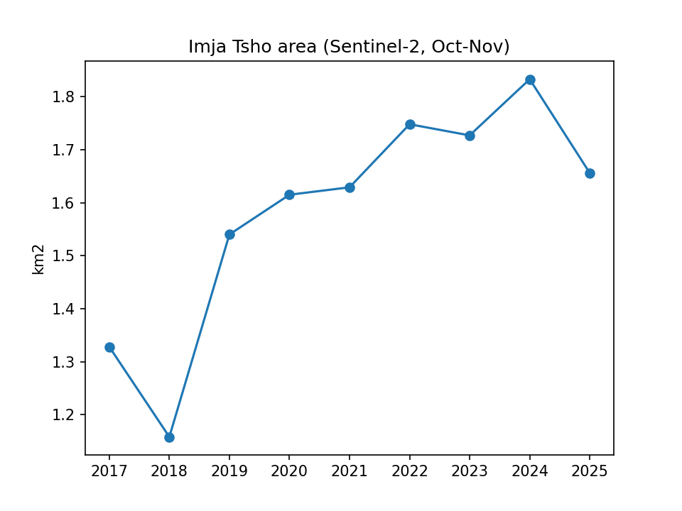

# Nepal Glacier Tracker

Tracks the growth of Nepal's high-risk glacial lakes using free satellite imagery and Google Earth Engine.

Glacial lakes in the Himalaya are growing as glaciers melt. If a moraine dam fails, the result is a glacial lake outburst flood (GLOF) that can hit villages downstream with little warning. This project measures how fast these lakes are growing, using public data that anyone can check.

v1 covers one lake: **Imja Tsho** (Everest region, Solukhumbu).

## Results: Imja Tsho, post-monsoon (Oct-Nov)

| Year | Area (km²) | Images used |
|------|-----------:|------------:|
| 2017 | 1.328 | 2 |
| 2018 | 1.158 | 2 |
| 2019 | 1.540 | 5 |
| 2020 | 1.615 | 11 |
| 2021 | 1.629 | 9 |
| 2022 | 1.748 | 9 |
| 2023 | 1.727 | 8 |
| 2024 | 1.833 | 7 |
| 2025 | 1.656 | 9 |

The lake grew roughly 30% between 2017 and 2024.

## How it works

1. Pulls Sentinel-2 surface reflectance imagery (`COPERNICUS/S2_SR_HARMONIZED`) for October-November each year, when skies are clearest and the lake is not yet frozen
2. Masks clouds, cloud shadow, and snow using the Sentinel-2 scene classification band
3. Builds a median composite and computes NDWI (green vs near-infrared); pixels above 0.2 count as water
4. Converts water to polygons and keeps only the largest one, so nearby ponds and supraglacial melt ponds are excluded
5. Writes the yearly area to `imja_tsho_area.csv` and a chart to `imja_tsho_area.png`

## Run it

~~~
python3 -m venv venv
source venv/bin/activate
pip install earthengine-api matplotlib
python -c "import ee; ee.Authenticate(auth_mode='notebook')"
python glacier_lake_area.py
~~~

Requires a Google Cloud project registered for Earth Engine. Change `PROJECT` in the script to your own.

## Data caveats

- 2017 and 2018 use only 2 images each, so those values are less reliable
- Mountain shadow, early lake ice, or debris at the lake edge can shift a year's value; the 2025 dip may be one of these
- 10 m pixels mean the shoreline is approximate; treat small year-to-year changes as noise and look at the overall trend
- These figures have not been validated against field surveys or published studies

## Disclaimer

This is an independent learning project. It is **not** an official hazard assessment or warning system. For official information, refer to Nepal's Department of Hydrology and Meteorology (DHM) and ICIMOD.

## Roadmap

- Add more high-risk lakes (Tsho Rolpa, Thulagi, and others)
- Extend history back with Landsat imagery
- Post periodic updates to the [Nepal River Watch](https://github.com/Tilakthapa3/nepal-river-watch) Telegram channel

## Related

[nepal-river-watch](https://github.com/Tilakthapa3/nepal-river-watch): live DHM river gauge monitor with Telegram alerts

## Results: Tsho Rolpa, post-monsoon (Oct-Nov)

Rolwaling Valley, Dolakha. Measured in the Earth Engine Code Editor with the same method (Sentinel-2, NDWI > 0.2, largest water body only).

| Year | Area (km²) |
|------|-----------:|
| 2017 | 1.571 |
| 2018 | 1.584 |
| 2019 | 1.636 |
| 2020 | 1.637 |
| 2021 | 1.629 |
| 2022 | 1.648 |
| 2023 | 1.643 |
| 2024 | 1.654 |
| 2025 | 1.651 |

Tsho Rolpa grew about 5% from 2017 to 2025, much slower than Imja Tsho's roughly 30%, with growth at the glacier (southeast) end.
